# SynAudit: Real-Time Quality and Privacy Monitoring for Streaming Synthetic Data

**Course:** Text, Audio, Image and Stream Mining, ELTE

**Team:** Matilda Migwi, Diana Grigoryan, Grace Mbira, Sharon Jepngetich, Alina Amanbekova

---

## Abstract

SynAudit generates synthetic versions of two tabular datasets (UCI Adult and UCI Default of Credit Card Clients), streams real and synthetic records through Kafka, and monitors the synthetic stream live for statistical quality, distribution drift, machine-learning utility and privacy risk. Results are stored in InfluxDB and shown in a Streamlit dashboard. *(Final results summary to be added after the end-to-end run.)*

## Contents

1. Introduction and objectives
2. System architecture
3. Environment setup
4. Data ingestion (Matilda)
5. Synthetic data generation and quality evaluation (Diana)
6. Drift detection (Grace)
7. ML utility and privacy (Sharon)
8. Storage, sketches and dashboard (Alina)
9. End-to-end execution
10. Results
11. Known issues and limitations
12. Conclusion and future work
13. References

---

## 1. Introduction and objectives

Synthetic data is used to share or test with data that resembles real records without exposing them. The risk is that synthetic data can be too poor to be useful or too close to the real data to be private. SynAudit checks both continuously on a stream instead of once on a static file.

Objectives:

- Generate synthetic Adult and Credit Default data with SDV.
- Stream real and synthetic records through Kafka using one shared message contract.
- Measure quality (statistical similarity), drift, ML utility (TSTR/TRTR) and privacy (exact-copy detection) on the stream.
- Store and visualise all metrics in one dashboard.

## 2. System architecture

Real datasets are downloaded and preprocessed into canonical CSV files. The
synthetic generator fits those files offline and writes synthetic CSVs and metadata.
The producer publishes both sources to four Kafka topics.

Reservoir sampling, DGIM, quality monitoring and sketches consume Kafka independently.
Reservoir sampling writes bounded reference samples to JSON; DGIM writes approximate
recent-window rates to JSON and attempts to write them to InfluxDB. Quality and sketches
also produce monitoring results. In this implementation, utility, privacy and the
configured drift job read CSVs as batch jobs. They do not consume reservoir snapshots.
InfluxDB supplies the Streamlit dashboard.

**Reservoir sampling is a parallel Kafka reader, not a stage that DGIM or generation
must wait for.** Running it with `docker compose run` still runs it inside Docker.

## 3. Environment setup

**Requirements:** Python 3.11, Docker Desktop with Docker Compose, Git.

Dependencies are in two files at the repository root:

- `requirements.txt` — runtime dependencies for the services. Installed in the host virtual environment and in every Docker image (`quality`, `sketches`, `dashboard`, `jobs`), all on `python:3.11-slim`, so Docker builds the dependency layer once and shares it.
- `requirements-generation.txt` — the synthetic-data generator only (`sdv`, which pulls in PyTorch). Host-only; it is **not** installed in any Docker image, because no container generates data. Installing it also installs everything in `requirements.txt`.

```bash
git clone https://github.com/sharonjepngetichsaina/SynAudit.git
cd SynAudit
python -m venv .venv
source .venv/Scripts/activate            # Windows Git Bash; on Linux/macOS: source .venv/bin/activate
pip install -r requirements-generation.txt   # host: runtime + generator (sdv)
python -c "import pandas, sdv, sdmetrics, river, kafka, influxdb_client, streamlit, sklearn, matplotlib; print('OK')"
```

Expected output: `OK`.

Notes:

- `sdv` pulls in PyTorch, so the first host install takes several minutes. The Docker images do not install it, which keeps them small and the build fast.
- Earlier versions had five separate requirements files with conflicting Kafka clients (`kafka-python` vs `kafka-python-ng`). These were consolidated, and the generation-only `sdv` dependency was separated so the containers don't carry PyTorch.

## 4. Data ingestion (Matilda)

Detailed component instructions: [docs/01_DATA_INGESTION.md](docs/01_DATA_INGESTION.md).
Use section 9 below for the Docker reservoir workflow and execution order.

| Component | Role | Output |
|---|---|---|
| Acquisition and preprocessing | Download UCI data and preserve the agreed feature schema and missing values | `data/processed/adult.csv`, `data/processed/credit-default.csv` |
| Kafka producer | Publish canonical real and synthetic rows with dataset/source/record identity | `adult-real`, `adult-synthetic`, `credit-default-real`, `credit-default-synthetic` |
| Reservoir sampling | Algorithm R; uniform sample of up to 1,000 arrivals from the retained topic, using bounded memory | `data/reference/<dataset>-<source>-reservoir.json` |
| DGIM | Approximate counts/rates of binary conditions over a recent window | `data/reference/<dataset>-<source>-dgim.json`, plus InfluxDB writes when available |

The reservoir algorithm lives in `ingestion/reservoir.py`. The service in
`ingestion/reservoir_service.py` reads Kafka with `group_id=None`,
`enable_auto_commit=False` and `auto_offset_reset="earliest"`. It therefore does not
compete with DGIM's consumer group. Each invocation rebuilds its sample from retained
history; it does not resume an old sample. `--from-start` remains accepted for compatibility.

The Compose `reservoir` service uses the existing `synaudit-jobs:latest` image and
mounts the current checkout at `/app`. Its `tools` profile keeps it out of ordinary
`docker compose up`. Invoke it explicitly after records have been published; it writes
its final snapshot and exits after 15 seconds without new records. No host Python
installation or new Docker image build is needed for this step if the jobs image exists.
Do not run two sampling jobs for the same topic concurrently: they share an output path.

Each snapshot records `dataset`, `source`, `reservoir_size`, `records_seen`,
`records_held`, `inclusion_probability`, `written_at` and `sample`. For N arrivals,
`records_held` must be `min(1000, N)`. Equal payloads can occur in a valid sample:
the algorithm samples arrivals, not distinct people or unique rows. Reproducibility
requires the same seed and ordered input stream.

These are independent reference artifacts. Current quality monitoring uses recent
real/synthetic windows; utility and privacy use CSV inputs. Creating reservoirs does
not switch their input source. In particular, replacing the full real data with a
small sample would weaken an exact-copy privacy check.

## 5. Synthetic data generation and quality evaluation (Diana)

Run instructions: `docs/02_DATA_SYNTHESIS_AND_QUALITY.md`.

Each synthetic dataset has 40,000 generated rows with no duplicates. An earlier version held a 10,000-row batch twice plus 20,000 new rows, and some services read a different, stale synthetic file. Both problems were fixed before this run.

### 5.1 Generation method

The generator fits SDV's `GaussianCopulaSynthesizer` on the processed real data. A Gaussian copula models each column's marginal distribution separately and links them through a correlation matrix of normal variables. Two Adult-specific problems are handled before fitting:

- **Zero-inflated columns.** `capital_gain` and `capital_loss` are mostly zeros. A copula smooths the spike at 0 into a continuous distribution, which inflates the mean. Zeros are treated as missing during fitting, so the model learns the zero/non-zero decision separately, and they are restored to 0 after sampling.
- **Deterministic column pairs.** `education_num` is a fixed function of `education`. Modelled independently, the pair can contradict itself (for example `HS-grad` with `education_num` 14). The mapping is learned from the real data, `education_num` is dropped before fitting, and it is derived from `education` after sampling.
- **Invalid categorical combinations (Adult).** The copula reproduces each column's shares but links columns through one correlation matrix, so without a constraint it generates impossible rows such as a female `Husband` or a `Husband` who is not married. An SDV `FixedCombinations` constraint on (`relationship`, `sex`, `marital_status`) merges those columns into one before fitting, so only combinations present in the real data can be sampled.
- **Integer status codes (Credit Default).** `pay_0`, `pay_2`..`pay_6` are repayment-status codes with a large spike at 0 ("paid on time"). Modelled as continuous numbers the spike is smeared (52% of real rows at 0 became 31% synthetic). They are modelled as categorical in the fit metadata, so each code's frequency is matched; the saved metadata keeps them numeric, so downstream services are unaffected.
- **Heavy-tailed money columns (Credit Default).** `bill_amt*` use a `truncnorm` marginal bounded to the real range, which stops the over-spread of the default fit. `pay_amt*` are a spike of zeros (~20%) plus a heavy tail, so they use the same zero-inflation path as `capital_gain`. Two other approaches were tried and rejected: a signed-log transform (its convex inverse amplified tail errors into values 10-40x too large) and a KDE marginal (needs an N x N matrix and exhausts memory at this data size).
- **Duplicates.** Rows are sampled independently, so identical rows can occur by chance. The generator removes duplicates and samples again until it has the requested number of unique rows. Synthetic rows that happen to match a real record are deliberately kept, so the privacy check (section 7) can detect them.

### 5.2 Generation results: Adult

`python scripts/generate_synthetic.py --dataset adult --num-rows 40000 --seed 42`

| Check | Real | Synthetic |
|---|---|---|
| Rows × columns | 48,842 × 14 | 40,000 × 14 |
| Duplicate synthetic rows | — | 0 |
| `capital_gain`: share of zeros | 91.7% | 91.6% |
| `capital_gain`: mean | 1,079.1 | 1,093.3 |
| `capital_loss`: share of zeros | 95.3% | 95.3% |
| `capital_loss`: mean | 87.5 | 88.5 |
| `education` → `education_num` consistent | 100% | 100% |

The zero shares match within 0.15 percentage points, and the means are within 1.5%. Before the zero-inflation fix, the synthetic mean of `capital_gain` was about 35,784, roughly 33 times the real value.

### 5.3 Generation results: Credit Default

`python scripts/generate_synthetic.py --dataset credit-default --num-rows 40000 --seed 42`

| Check | Real | Synthetic |
|---|---|---|
| Rows × columns | 30,000 × 24 | 40,000 × 24 |
| Duplicate synthetic rows | — | 0 |
| `pay_2` share at code 0 | 52.4% | 52.2% |
| `pay_amt1` mean / zero share | 5,664 / 17.5% | 5,534 / 17.4% |
| `bill_amt1` mean / std | 51,223 / 73,636 | 51,224 / 73,676 |

Credit Default needed its own fixes, different from Adult's, because its columns differ: integer status codes and heavy-tailed money amounts rather than text categories with logical rules. The `pay_*` codes are modelled as categorical, and the money columns use `truncnorm` (`bill_amt*`) and the zero-inflation path (`pay_amt*`), as described in section 5.1. With those, no impossible negatives and no invalid codes appear, which was confirmed separately.

The synthetic set (40,000 rows) is larger than the real one (30,000). This is valid because rows are drawn from the fitted distribution rather than copied, but the privacy check in section 7 compares 40,000 synthetic rows against 30,000 real ones. We kept 40,000 rather than matching the real size for two reasons. The drift detectors (section 6) were calibrated on a 40,000-record synthetic stream. The utility check (section 7) already trims real and synthetic training sets to the same size, so the extra rows give the synthetic model no advantage.

### 5.4 Batch quality evaluation

`scripts/evaluate_quality.py` compares synthetic against real data on missing values, duplicates, numeric distributions, categorical distributions (total variation distance, TVD), correlation structure, logical consistency, zero-inflation and the SDMetrics quality report. Outputs are written to `results/`.

#### Adult

| Metric | Result |
|---|---|
| Missing-value rate: `workclass` / `occupation` / `native_country` | real 5.73% / 5.75% / 1.75% vs synthetic 5.74% / 5.70% / 1.74% |
| Duplicate rows | real 6,374 (13.0%), synthetic 0 |
| Numeric standardized mean difference (max) | 0.015 (`age`) |
| Categorical TVD (max) | 0.0089 (`relationship`) |
| Mean absolute correlation difference | 0.058 |
| `education` → `education_num` consistency | 100% |
| Zero-share gap: `capital_gain` / `capital_loss` | 0.001 / 0.000 |
| SDMetrics overall | **0.938** |
| SDMetrics column shapes | 0.972 |
| SDMetrics column pair trends | 0.904 |

**Interpretation.** The marginal distributions (each column on its own) are reproduced closely. All categories are present, every TVD is below 0.01, numeric means are within 0.02 standard deviations, and the missing-value rates match. Two weaknesses remain:

1. **Tails are truncated.** Real `capital_gain` reaches 99,999 (std 7,452), synthetic only 33,738 (std 3,805). In Adult, 99,999 is a top-code shared by a few hundred records. A Gaussian copula cannot reproduce an isolated cluster that far out, so the mean is preserved but extreme cases are under-represented.
2. **Dependencies between columns are weaker than the marginals.** Column pair trends (0.90, against 0.97 for column shapes) and the correlation difference (0.058) show that the joint structure is less faithful than the individual columns. A Gaussian copula encodes categories as numbers and cannot, on its own, express logical rules such as *relationship = Husband ⇒ sex = Male*.

**Invalid combinations before and after the `FixedCombinations` constraint:**

| Combination | Before | After | Real |
|---|---|---|---|
| `Husband` + `Female` | 13.06% | 0.01% | 0.00% |
| `Wife` + `Male` | 3.10% | 0.01% | 0.01% |
| Spouse (`Husband`/`Wife`) but not `Married-*` | 23.60% | 0.00% | 0.00% |

Without the constraint, about a quarter of synthetic rows described an unmarried "spouse" and one in eight a female "Husband". With the constraint, the synthetic rates match the real data, which contains the same 0.01% residual. The generator's self-check reports a valid `relationship + sex + marital_status` combination in 100% of rows.

The 13% duplicate rate in the real data comes from dropping `fnlwgt` (see [`docs/01_DATA_INGESTION.md`](docs/01_DATA_INGESTION.md)). It matters for the privacy check: a synthetic row equal to a frequent real row is not necessarily a leak.

#### Credit Default

| Metric | Baseline (default fit) | After fixes |
|---|---|---|
| SDMetrics overall | 0.886 | 0.869 |
| SDMetrics column shapes | 0.853 | **0.899** |
| SDMetrics column pair trends | 0.920 | 0.839 |
| `pay_*` zero-code gap (max) | 0.24 | 0.008 |
| `pay_amt*` standardized mean difference (max) | 0.17 | 0.010 |
| `bill_amt1` std ratio (synthetic / real) | 1.5 | 1.00 |
| Mean absolute correlation difference | 0.083 | 0.089 |

**Interpretation.** The per-column fidelity improved substantially: the `pay_*` zero-code gap fell from 0.24 to 0.008, the `pay_amt*` means are now within 1%, and `bill_amt1`'s over-spread is gone. Column shapes rose from 0.85 to 0.90.

The trade-off is that column pair trends fell from 0.92 to 0.84, so the overall score is marginally below the baseline. Modelling `pay_*` as categorical fixes their marginal distribution but weakens how the copula represents their correlation with the other columns, and the repayment-status codes are correlated with default and with the money columns. The fixes were kept because the defects they remove (for example a status code showing 31% zeros where the real data has 52%) are visible on inspection and are exactly what the monitoring should not have to report as a generator failure, whereas the pair-trend change is subtler; and because categorical is the correct model for an ordinal code.

**Residual limitation.** The extreme tail of `pay_amt*` is compressed: the synthetic maximum is about 90,000 against a real maximum near 870,000. The mean and spread are correct, so a handful of very large payments are under-represented.

### 5.5 Streaming quality monitoring: CluStream and DenStream

The batch checks in 5.4 compare two complete files. The streaming monitor (`quality/monitor.py`, `quality/consumer.py`) repeats a lighter version of them on the live Kafka stream: it keeps a sliding window of the last 500 real and 500 synthetic records, re-scores every 100 new synthetic records, and runs SDMetrics every fifth window (Adult) or every tenth window (Credit Default). Alongside those statistics it clusters both streams, so it can tell whether the synthetic stream occupies the same regions of feature space as the real one, not only whether the column statistics agree. `quality/clustering.py` implements two stream clustering algorithms from their papers, once per source (real, synthetic) and with identical parameters.

- **CluStream** (Aggarwal et al., 2003). Online phase: each record is absorbed into the nearest of at most *q* micro-clusters, each stored as a cluster feature vector (count, linear sum, squared sum, and the same for timestamps). A record that falls outside the nearest cluster's maximal boundary opens a new micro-cluster, and when the limit is reached the oldest cluster is deleted or the two closest are merged. Offline phase: weighted k-means (k = 5) over the micro-cluster centroids gives macro-clusters. The pyramidal time frame of the paper is left out because only the current clustering is needed. *q* is 40 for Adult and 60 for Credit Default.
- **DenStream** (Cao et al., 2006). Micro-clusters have a weight that decays over time (2^(-λ·age), λ = 0.002) and are kept as potential or outlier micro-clusters; an outlier is promoted when its weight reaches β·μ and dropped when it decays or is pruned. Offline phase: a DBSCAN-style pass over the potential micro-clusters gives macro-clusters and leaves noise points out. The parameters are ε = 0.12 and μ = 8 for Adult, ε = 0.30 and μ = 8 for Credit Default, with β = 0.3.

Numeric features are scaled to [0, 1] with the ranges in the SDV metadata, so a single distance threshold applies to every column. Each window is compared with three scores per algorithm:

- **Centroid distance:** the distance between optimally matched real and synthetic cluster centres.
- **Membership TVD:** the total variation distance between the shares of real and synthetic records falling into each real cluster.
- **Coverage ratio:** the ratio of the synthetic to the real mean distance to the nearest real micro-cluster. About 1 means the synthetic points lie where the real ones do.

### 5.6 Limitations

- **Zero bills are lost (Credit Default).** The real `bill_amt1`–`bill_amt6` contain 6.7–13.4% zeros, but the synthetic data has none, because `bill_amt*` have no zero-inflation path like `pay_amt*`.
- **Tails and spread are compressed.** Synthetic maxima reach only 5–41% of the real ones for `bill_amt*` and `pay_amt*`, and the standard deviation is also too low for `pay_amt*` (36–45% of real) and `capital_gain` (51%), although the means match.
- **Column types are not handled consistently.** The batch evaluator picks numeric columns from pandas dtypes, so integer-coded categories (`pay_*`, `sex`, `education`, `marriage`, the default flag) are scored as numbers, and in the saved metadata `pay_0`, `pay_2`–`pay_4` are numerical while `pay_5` and `pay_6` are ordinal.
- **Quality scores miss the loss of the feature–label relationship.** SDMetrics is high (0.94 Adult, 0.87 Credit Default), yet a model trained on the synthetic data performs at chance level (section 7.4), and section 5 has no label-aware check.
- **Statistical coverage is limited.** The standardized mean difference only compares means and the correlation difference is Pearson-based, so nonlinear and categorical–numerical dependencies are not measured directly, and column pair trends (0.90 and 0.84) are below column shapes (0.97 and 0.90).
- **Consistency rules exist for Adult only.** Three rules are checked for Adult (the `education`, `relationship`, `sex` and `marital_status` pairs); no business rules are checked for Credit Default.
- **One generator, one seed.** Only a Gaussian copula with seed 42 was run, so we cannot say how much scores vary between seeds or compared with other synthesizers.
- **Streaming monitor is simplified and uncalibrated.** Windows are the last 500 records of each stream, not matched by event time or sequence number, and the CluStream and DenStream parameters were set by hand with no calibrated alarm threshold (CluStream also omits the pyramidal time frame).


**Results.** The values below are means over the recorded windows after the first five (`results/stream/adult-windows.csv`, 330 windows; `results/stream/credit-default-windows.csv`, 605 windows).

| Metric | Adult CluStream | Adult DenStream | Credit CluStream | Credit DenStream |
|---|---|---|---|---|
| Centroid distance | 0.10 | 0.11 | 0.31 | 0.34 |
| Membership TVD | 0.07 | 0.22 | 0.40 | 0.50 |
| Coverage ratio | 1.23 | 1.22 | 1.32 | 1.38 |

On Adult the cluster structure of the two streams is close: CluStream's centres are about 0.1 apart in a [0, 1] space and the share of records in each cluster differs by 7%. Credit Default is clearly further apart, in line with its weaker column pair trends in 5.4 (0.84 against 0.90 for Adult). The membership TVD is also noisy from window to window on Credit Default (0.01 to 0.66 for CluStream), because a 500-record window gives only a few records per cluster. Treat these as monitoring signals that move when the synthetic stream degrades, not as a pass/fail threshold. The windows files are the numerical evidence for these figures, and no cluster-based alarm limit has been calibrated.

## 6. Drift detection (Grace)

**Question.** Does the synthetic stream stay stable over time, and if it changes, how quickly does the system notice?

A stream drifts when the distribution behind the records changes partway through. For a synthetic-data monitor, a drift alarm means that later batches from the generator no longer look like the earlier ones, so quality numbers measured at the start can no longer be trusted.

### 6.1 Method

Two families of detectors run side by side, because they answer different questions.

**Window tests (batch view).** The first 4,000 synthetic records form the *reference sample* (what "normal" looks like). The rest of the stream is cut into windows of 500 records, and each window is compared with the reference, column by column:

- numeric columns: two-sample Kolmogorov-Smirnov (KS) test
- categorical columns: chi-square test of homogeneity (rare categories under 1% are merged)

Adult has 13 tested columns (5 numeric, 8 categorical), so the significance level is Bonferroni-corrected: a column raises an alarm when p < 0.05 / 13 = 0.0038.

**Record-level change detectors (streaming view).** These read one value at a time and keep a memory, so evidence of a change builds up between windows. Values are standardised with the reference mean and standard deviation, so one set of parameters works for every column.

- **ADWIN** (Bifet & Gavaldà, 2007) keeps an adaptive window of recent values and drops the older part when the means of the old and new parts differ by more than a bound set by δ.
- **Page-Hinkley** (Page, 1954) accumulates deviations from the running mean, minus a tolerance δ, and signals a change when the sum rises more than λ above its minimum.

Column types (numeric or categorical) come from the SDV metadata file, so the detectors treat each column the same way the generator does.

### 6.2 Calibration on drift-free data

Every detector trades speed against false alarms. To choose parameters, `drift/calibration.py` runs each setting on the drift-free synthetic stream (5 seeds, 40,000 records) and on the same stream with a +0.5 std shift in `age`.

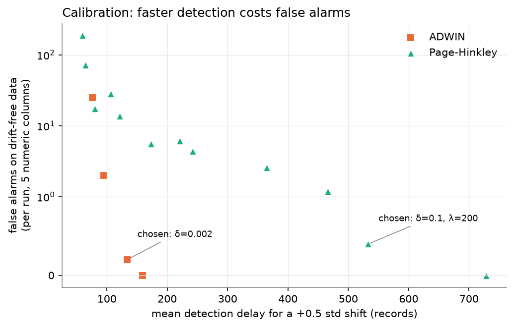

*Figure 6.1. Each point is one parameter setting. Lower is fewer false alarms; further left is faster detection. The chosen settings sit at the bottom of the curve.*

| Detector | Chosen setting | False alarms per run (5 columns, drift-free) | Mean delay, +0.5 std shift |
|---|---|---|---|
| ADWIN | δ = 0.002 | 0.2 | 133 records |
| Page-Hinkley | δ = 0.1, λ = 200 | 0.4 | 533 records |

Selection rule: at most one false alarm per run, then the shortest delay. ADWIN δ = 0.0002 removes the last false alarm but is 20% slower (159 records). Page-Hinkley δ = 0.25, λ = 200 has no false alarms but is 37% slower (729 records). In both cases we kept the faster setting, because a fraction of a false alarm per 36,000 records is cheaper than reacting hundreds of records later.

With these defaults, the false-alarm rate on drift-free data is 0.01 (ADWIN), 0.02 (Page-Hinkley), 0.03 (KS) and 0.10 (chi-square) alarms per 10,000 records per column.

### 6.3 Experiment E3: injected drift

`drift/experiment.py` injects known changes into the Adult synthetic stream and measures whether and how fast each detector finds them. Each seed shuffles the data and places the change point t0 at a random record, so t0 does not line up with window boundaries (which would favour the window tests). A detection counts only if it falls within 2,000 records after t0.

- **Numeric drift** in `age` and `hours_per_week`: sudden, or gradual (new values take over across 2,000 records), with sizes 0.1, 0.25, 0.5 and 1.0 std. 10 seeds × 2 columns = 20 runs per cell.
- **Categorical drift** in `marital_status`: 10%, 20% or 30% of `Married-civ-spouse` records relabelled as `Never-married`. 10 runs per cell.

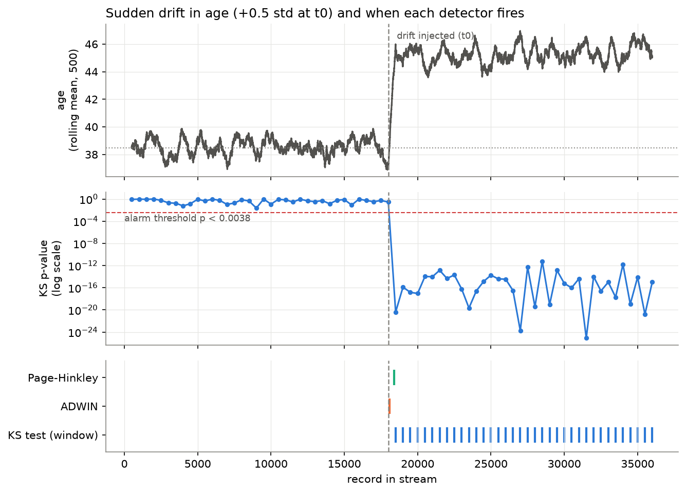

*Figure 6.2. A sudden +0.5 std shift in `age` (about 7 years). ADWIN fires almost at once and Page-Hinkley about 400 records later, and both then reset. The KS test fires on every window after t0, because it keeps comparing each window with the pre-drift reference.*

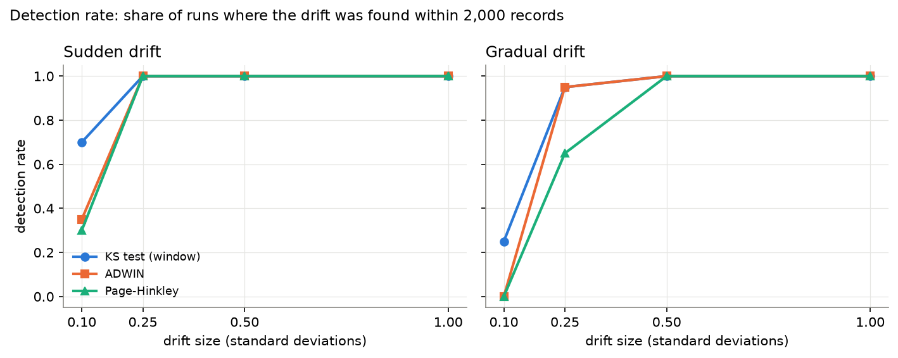

*Figure 6.3. Share of runs where the drift was found within 2,000 records.*

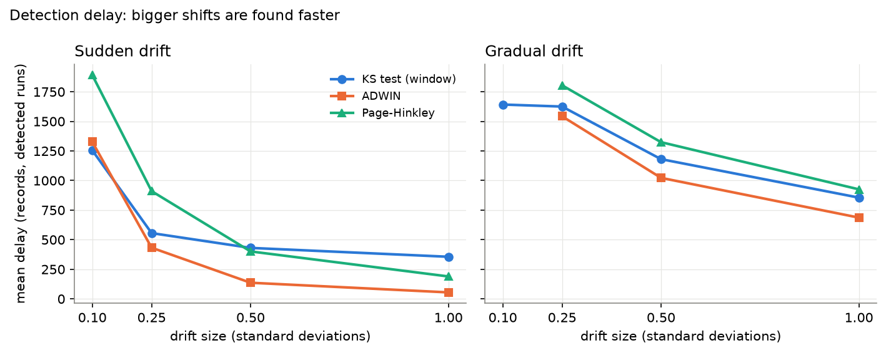

*Figure 6.4. Mean delay over the runs that detected the drift. A missing point means no run detected it.*

| Drift | Size | Detection rate (ADWIN / KS / PH) | Mean delay in records (ADWIN / KS / PH) |
|---|---|---|---|
| Sudden | 0.10 std | 0.35 / 0.70 / 0.30 | 1,327 / 1,255 / 1,891 |
| Sudden | 0.25 std | 1.00 / 1.00 / 1.00 | 432 / 556 / 910 |
| Sudden | 0.50 std | 1.00 / 1.00 / 1.00 | 136 / 431 / 401 |
| Sudden | 1.00 std | 1.00 / 1.00 / 1.00 | 55 / 356 / 189 |
| Gradual | 0.10 std | 0.00 / 0.25 / 0.00 | – / 1,642 / – |
| Gradual | 0.25 std | 0.95 / 0.95 / 0.65 | 1,543 / 1,625 / 1,805 |
| Gradual | 0.50 std | 1.00 / 1.00 / 1.00 | 1,023 / 1,181 / 1,324 |
| Gradual | 1.00 std | 1.00 / 1.00 / 1.00 | 687 / 856 / 925 |

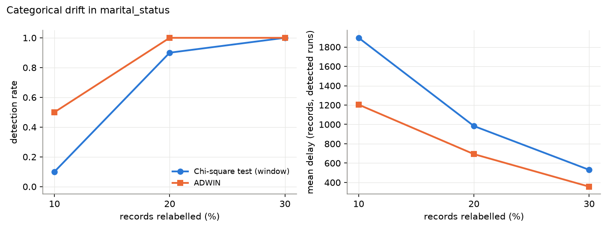

*Figure 6.5. Categorical drift in `marital_status`. ADWIN here watches the share of the affected category. The chi-square delay at 10% comes from a single detected run, so treat it as rough.*

| Records relabelled | Detection rate (ADWIN / chi-square) | Mean delay in records (ADWIN / chi-square) |
|---|---|---|
| 10% | 0.5 / 0.1 | 1,204 / 1,895 |
| 20% | 1.0 / 0.9 | 693 / 983 |
| 30% | 1.0 / 1.0 | 357 / 531 |

### 6.4 Findings

1. **Every detector finds drifts of 0.5 std or more, every time.** Below that, sensitivity separates them.
2. **ADWIN is the fastest once a shift is clear** (about 55 records for a 1 std sudden shift) and has the lowest false-alarm rate. It is the best single alarm for the live stream.
3. **The KS window test is the most sensitive to very small shifts** (70% detection at 0.1 std sudden) but can only react at window boundaries, so its delay never falls much below one window. It also keeps re-alarming after a drift, which makes it a good *state* indicator ("this window still differs") rather than a change alarm.
4. **Page-Hinkley is the most conservative.** It is slowest on small and gradual shifts, in exchange for almost no false alarms.
5. **Categorical drift needs about a 20% change before chi-square detects it reliably.** ADWIN on the category share reacts earlier and faster.

The detectors are complementary: ADWIN and Page-Hinkley signal *when* a change starts, and the window tests show *which columns* changed and whether the change persists.

### 6.5 Rerun on the corrected synthetic data

The first version of the 40,000-record synthetic files repeated rows 1–10,000 as rows 10,001–20,000. After Matilda regenerated the data without duplicates, calibration and E3 were rerun. The false-alarm counts on drift-free data were identical, and detection delays grew by about 5–15%. That is expected: without the repeated block, the stream has more natural variation, so the detectors need a little more evidence before alarming. The ranking of the detectors and the chosen parameters did not change.

### 6.6 Limitations

- E3 uses the Adult data only. On Credit Default, `pay_0`–`pay_4` are currently typed as numerical in the SDV metadata while `pay_5` and `pay_6` are ordinal, so the live job tests the first four with KS and the last two with chi-square. Once the metadata is aligned (an open point from the quality review in section 5), all six will use chi-square, which is the correct test for status codes.
- The reference sample is the start of the synthetic stream itself. The detectors therefore find change *within* the synthetic data, not the gap between synthetic and real data, which section 5 measures.
- Each E3 cell has only 10–20 runs, so differences in detection rate below about 0.15 (3 runs) are within noise.

**Reproduce:**

```bash
python -m drift.calibration
python -m drift.experiment
python -m drift.plots
```

Results: `results/drift/` · Figures: `results/drift/figures/` · Code: `drift/`

## 7. ML utility and privacy (Sharon)
**Question.** Is the synthetic data useful for training a model, and does it leak real records?

Synthetic data has two jobs that pull in opposite directions. It should be close enough to the real data that a model trained on it works on real people, and far enough that no real person can be found in it. This section measures both on the stream: ML utility with Hoeffding trees, and privacy with an exact-copy check backed by a Bloom filter.

### 7.1 ML utility: TSTR vs TRTR with Hoeffding trees

**Protocol.** Utility is measured with *train on synthetic, test on real* (TSTR, Esteban et al., 2017) against the baseline *train on real, test on real* (TRTR):

1. The real records are shuffled once (seed 42) and 20% are held out as a test set that no model ever trains on. The first 2,000 of these form the fixed test set.
2. Model **S** learns from the synthetic stream and model **R** from the remaining real records, one record at a time, in parallel.
3. Every 500 records both models are scored on the same 2,000 real test records.
4. Both training streams are cut to the same length, so S never sees more data than R. Adult: 39,000 records (78 windows). Credit Default: 24,000 records (48 windows).

Target labels: `income` (`>50K` is the positive class) for Adult and `default_payment_next_month` (1 is positive) for Credit Default.

**Algorithm.** Both models are **Hoeffding trees** (Domingos & Hulten, 2000), implemented with `river.tree.HoeffdingTreeClassifier`. A Hoeffding tree is a decision tree built for streams: it reads each record once, keeps only counts in its leaves, and never stores the data. A leaf is split only when the best attribute beats the second best by more than the Hoeffding bound

ε = √( R² ln(1/δ) / 2n ),

where R is the range of the split criterion, n the number of records seen in that leaf and δ the allowed probability of choosing the wrong attribute. With high probability the tree therefore makes the same splits a batch tree would make on all the data. That makes it a good fit for a stream monitor, because the utility score can be updated every window without retraining from scratch.

The eight Adult text columns (`workclass`, `education`, `marital_status`, `occupation`, `relationship`, `race`, `sex`, `native_country`) are passed to the tree as `nominal_attributes`. Without this, river 0.27 crashes on text values (`TypeError: must be real number, not str`). Credit Default is all-numeric.

**Metrics.** The classes are imbalanced (about 24% `>50K` in Adult, 22% defaults in Credit Default), so plain accuracy is misleading: a model that always predicts the majority class already scores 0.76–0.78. The main metric is therefore **balanced accuracy** (Brodersen et al., 2010), the mean of the recall on each class, where 0.5 means "no better than guessing". Accuracy and F1 are reported next to it. Two summary numbers are derived per window:

- utility gap = balanced accuracy R − balanced accuracy S (written to the CSV)
- utility ratio = balanced accuracy S / balanced accuracy R (computed in `storage/db.py` for the dashboard; 1.0 means the synthetic data is as useful as the real data)

### 7.2 Privacy: exact-copy check with a Bloom filter

**Question.** Does the generator output any record that is an exact copy of a real person?

Each row is turned into a fingerprint: all column values joined with `|`, with whole-number floats written as integers so that `39.0` and `39` match. A synthetic row whose fingerprint equals a real row's fingerprint is counted as a copy.

**Algorithm.** The real fingerprints are stored in a **Bloom filter** (Bloom, 1970), implemented from scratch in `privacy/bloom.py`. A Bloom filter is a bit array of m bits with k hash functions. Adding an item sets k bits; a lookup answers "seen" only if all k bits are set. It can give false positives but never false negatives: a "no" is always correct. For n items and a target false-positive rate p, the sizes are

m = −n ln p / (ln 2)²  bits,  k = (m / n) ln 2  hash functions.

With p = 1%, the filter for Adult (48,842 real rows) uses m = 468,154 bits (about 57 KB) and k = 7; for Credit Default (30,000 rows) m = 287,552 bits (about 35 KB) and k = 7. The k positions come from one SHA-256 digest by double hashing, (h₁ + i·h₂) mod m (Kirsch & Mitzenmacher, 2006), so results are reproducible across runs.

**Procedure.** `privacy/copy_check.py`:

1. Streams the real rows into the filter, checking each one before adding it. This gives a baseline: how often real rows repeat earlier real rows.
2. Streams all 40,000 synthetic rows and checks each against the filter.
3. Checks the same rows against an exact Python `set` of real fingerprints. The exact set is only there to measure the Bloom filter's error; in a deployment with a large or growing reference, the filter alone would be kept.
4. Every 500 synthetic rows, writes the cumulative Bloom and exact copy rates.

`privacy/test_bloom.py` checks the implementation: after adding 10,000 items, every one is found again (no false negatives), and 10,000 unseen items give a false-positive rate of about 1%.

### 7.3 Results

All numbers are from the run on the corrected 40,000-row synthetic data (no repeated block, see section 6.5), at the last window.

**Utility**

| Dataset | Balanced accuracy TRTR (R) | Balanced accuracy TSTR (S) | Utility gap | Utility ratio | F1 R / S |
|---|---|---|---|---|---|
| Adult | 0.743 | 0.500 | 0.243 | 0.67 | 0.63 / 0.00 |
| Credit Default | 0.635 | 0.500 | 0.135 | 0.79 | 0.43 / 0.00 |

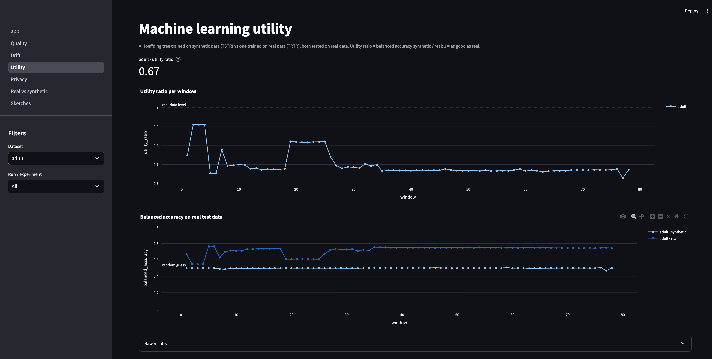

*Figure 7.1. Dashboard utility page: balanced accuracy of both models per window and the utility ratio.*

**Privacy**

| Dataset | Synthetic rows checked | Exact copies | Bloom filter "seen" | Bloom false positives |
|---|---|---|---|---|
| Adult | 40,000 | 0.70% (281 rows) | 1.14% | 0.43 points |
| Credit Default | 40,000 | 0% | 0.94% | 0.94 points |

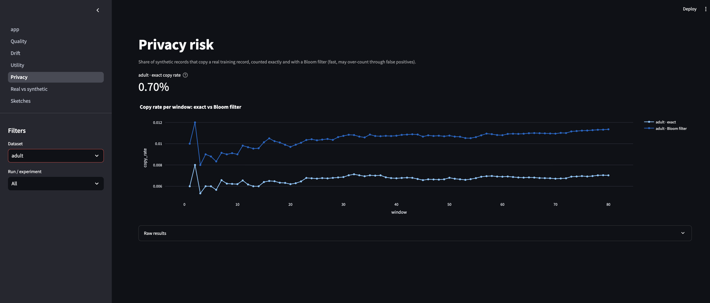

*Figure 7.2. Dashboard privacy page: exact and Bloom-filter copy rate per window.*

### 7.4 Findings

1. **The real-data model learns; the synthetic-data model does not.** R reaches 0.743 (Adult) and 0.635 (Credit Default). S stays at chance level throughout: exactly 0.500 in every Credit Default window, and between 0.47 and 0.51 on Adult. At the last window it predicts the majority class (`<=50K`, no default) for every test record (F1 = 0), which is why its plain accuracy (0.755 and 0.78) looks deceptively good.
2. **The cause is the synthetic labels, not the model.** In the synthetic data the label looks almost independent of the features. For example, the share of `>50K` by `relationship` is 16–27% in every group of the synthetic Adult data, but 1–47% in the real data. On Credit Default S predicts the majority class in every window. On Adult it sometimes predicts `>50K`, but those predictions carry no real signal (F1 at most 0.15 in any window). The same code and settings learn normally on real data, so the utility check is working as intended: it is flagging a real weakness of the generator (section 5), which marginal quality scores alone did not show.
3. **The Hoeffding tree needs evidence before it splits.** On Credit Default, R also stays at 0.500 for the first windows, then rises once enough records have reached a leaf to pass the bound. This shows the trade-off in δ: a split is safe but delayed.
4. **No Credit Default record is copied.** Every Bloom "seen" there is a false positive, and the 0.94% rate matches the 1% target.
5. **0.70% of synthetic Adult rows equal a real row, below our 1% alert level.** These are not necessarily leaks. Without `fnlwgt`, 13% of real Adult rows already repeat another real row (section 5.4), so many combinations are common profiles that a generator can produce by chance. A copy rate far below the real-data repeat rate suggests the generator is not memorising records.
6. **The Bloom filter never missed a copy.** On both datasets its rate is the exact rate plus its false positives. On Adult the false-positive share (0.43 points) is below 1% because the duplicate real rows mean fewer distinct items were added than the filter was sized for, so fewer bits are set.

The two checks together show the usual privacy–utility tension in an extreme form: the current synthetic data is safe (almost no copies) partly because it has lost the feature–label relationship that would make it useful.

### 7.5 Limitations

- **One model family.** Utility is measured with a Hoeffding tree only. A stronger or batch model (for example gradient boosting) could extract a weak signal the tree misses, so a ratio of 0.67 is a lower bound on what the synthetic data could support.
- **Fixed test set of 2,000 records.** All windows use the same real test rows, so the scores are directly comparable over time, but each balanced accuracy has a sampling error of roughly ±0.01–0.02, so changes smaller than that between windows are noise.
- **Exact copies only.** The check finds identical rows. A synthetic row that differs from a real row in one column is not flagged, although it may still identify the person. Distance to closest record (DCR) and membership-inference attacks (`median_dcr`, `mia_auc` in the InfluxDB schema) are not computed yet.
- **Exact set kept for validation.** For a fair comparison, `copy_check.py` also keeps the full set of real fingerprints. A production version would keep only the Bloom filter and accept its 1% false positives.
- **Batch jobs, not Kafka consumers.** Like drift (section 8.5), both jobs read the CSV files and then stream them internally, so the dashboard pages fill at once instead of window by window.

**Reproduce (Docker):**

```bash
docker compose -f docker/docker-compose.yml build
docker compose -f docker/docker-compose.yml up -d influxdb dashboard
docker compose -f docker/docker-compose.yml run --rm --no-deps utility-adult
docker compose -f docker/docker-compose.yml run --rm --no-deps utility-credit-default
docker compose -f docker/docker-compose.yml run --rm --no-deps privacy-adult
docker compose -f docker/docker-compose.yml run --rm --no-deps privacy-credit-default
```

The jobs need `data/processed/` and `data/synthetic/` from sections 4 and 5. Each job runs once, writes its CSV and its InfluxDB measurement (`utility` or `privacy`), and exits with code 0. Results then appear on the Utility and Privacy pages at http://localhost:8501.

**Reproduce (host):**

```bash
python utility/tstr.py --dataset adult
python utility/tstr.py --dataset credit-default
python privacy/test_bloom.py
python privacy/copy_check.py --dataset adult
python privacy/copy_check.py --dataset credit-default
```

Results: `results/utility/`, `results/privacy/` · Code: `utility/`, `privacy/`

## 8. Storage, sketches and dashboard (Alina)

**Question.** How do the results of all services reach one place, and can category frequencies and distinct counts be tracked on the stream in fixed memory?

### 8.1 Storage: one write and read layer

Every service writes through one module, `storage/db.py`, into one InfluxDB 2.7 bucket (`synaudit`). Each check has its own measurement:

| Measurement | Written by | Content per window |
|---|---|---|
| `synaudit_quality`, `synaudit_column_quality` | quality service (`quality/sinks.py`) | SMD, TVD, correlation difference, SDMetrics, cluster coverage |
| `drift_events` | drift job (`db.write_drift_rows`) | statistic, p-value, alarm per column and detector |
| `utility` | utility job (`db.write_utility_rows`) | balanced accuracy TSTR/TRTR, utility ratio |
| `privacy` | privacy job (`db.write_privacy_rows`) | exact and Bloom-filter copy rate |
| `dgim` | DGIM service (`db.write_dgim_snapshot`) | approximate rate per condition, real and synthetic |
| `sketches`, `sketch_freq` | sketch service | HyperLogLog and Count-Min estimates, errors, memory, category shares |

Design decisions:

- **No format changes for the other services.** Each `write_*` function accepts the rows a service already produces (its CSV columns or JSON snapshot). Integration only added one call at the end of each script, inside `try/except`, so a script without a running database still writes its CSV/JSON as before.
- **Tags vs fields.** `dataset`, `source`, `column`, `detector`, `predicate` and `run_id` are tags (used to filter); measured values are fields. Counters (`window`, `alarm`, `rows_seen`, ...) are always written as integers, because InfluxDB rejects a field whose type changes.
- **Re-runs replace, not duplicate.** Batch jobs delete earlier rows of the same measurement and dataset before writing. Without this, a second `docker compose up` doubled the drift alarms.
- **Configuration through environment variables** (`INFLUX_URL`, `INFLUX_TOKEN`, `INFLUX_ORG`, `INFLUX_BUCKET`), so the same code runs on the host (`localhost:8086`) and in Docker (`influxdb:8086`).

Reading uses one Flux query per page (`db.read`): filter by measurement and dataset, then `pivot` the fields into one row per window, returned as a pandas DataFrame.

### 8.2 Dashboard

A Streamlit app (`dashboard/`, http://localhost:8501) reads InfluxDB every 5 seconds, so the charts grow while the stream runs. Every page has a dataset filter. Dashed lines show alert thresholds, and a warning appears when the latest window crosses one (for example SDMetrics below 0.8 or a zero-share gap above 0.1).

| Page | Shows |
|---|---|
| Overview | latest quality, drift alarms, utility ratio and exact-copy rate per dataset |
| Quality | SMD/TVD per window, correlation difference, SDMetrics, CluStream vs DenStream coverage, per-column distances |
| Drift | p-value per column and window, alarm map, alarm log |
| Utility | utility ratio and balanced accuracy (TSTR vs TRTR) |
| Privacy | exact vs Bloom-filter copy rate |
| Real vs synthetic | DGIM rates of each condition in both streams and their gap |
| Sketches | Count-Min category shares, HyperLogLog distinct counts and their errors |

Screenshots after a full end-to-end run (all four streams published, 40,000 synthetic records per dataset):

| Overview | Quality |
|---|---|
| 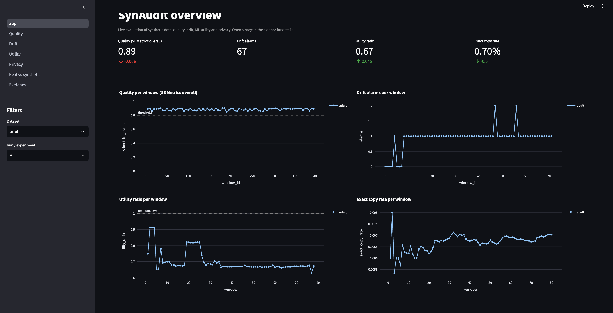 | 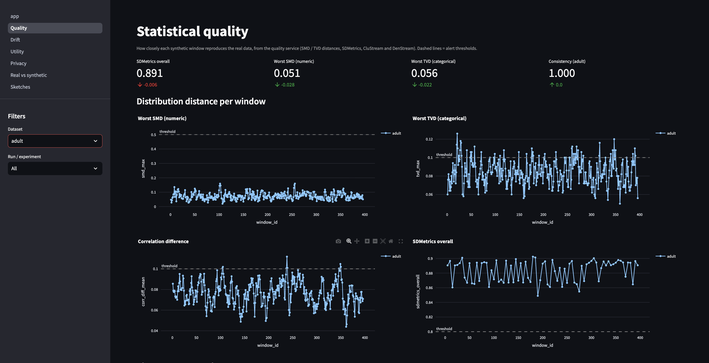 |
| **Drift** | **Utility** |
| 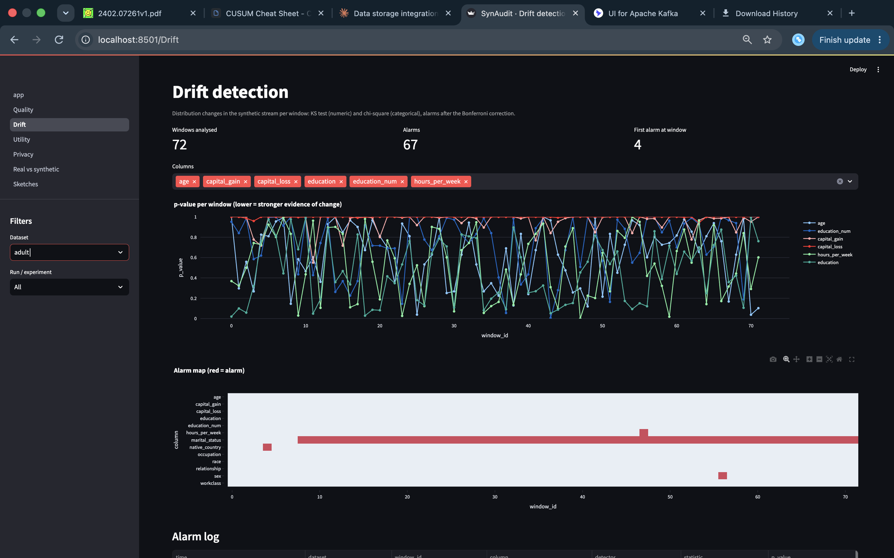 |  |
| **Privacy** | **Real vs synthetic (DGIM)** |
|  | 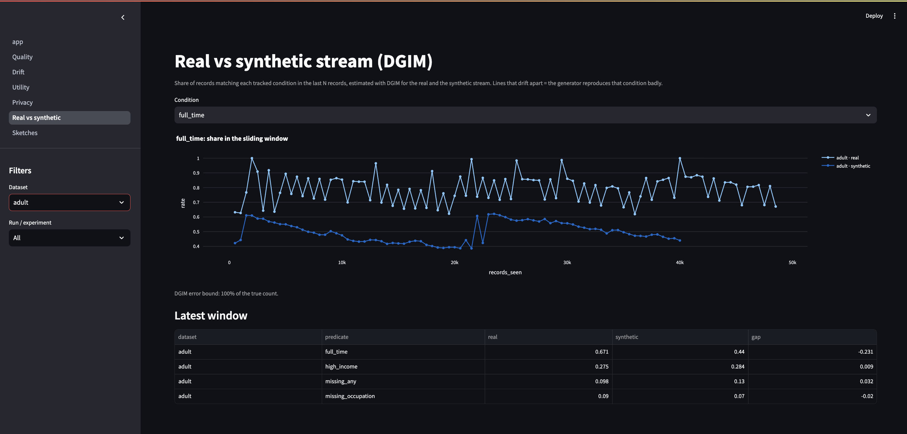 |

*Figure 8.1. All dashboard pages. Each page reads its own measurement from InfluxDB; the numbers are discussed in the owner's section (4–7).*

On that run the overview showed SDMetrics overall of about 0.89 (Adult) and 0.81 (Credit Default), both above the 0.8 threshold, 67 drift alarms in the injected-drift test, a utility ratio of 0.67 and an exact-copy rate of 0.70% (Adult) and 0% (Credit Default). These match the numbers reported by the individual services.

### 8.3 Sketches: Count-Min Sketch and HyperLogLog

The sketch service (`sketches/sketch_service.py`) reads both topics of a dataset from Kafka (consumer group `synaudit-sketches`) and keeps one Count-Min Sketch and one HyperLogLog per categorical column and stream. Every 1,000 records it writes estimates, exact reference values and memory use to InfluxDB.

- **Count-Min Sketch** (Cormode & Muthukrishnan, 2005) estimates how often each value occurs. A table of d × w counters (d = 5, w = 272); each row has its own hash function, an update adds 1 to one cell per row, and the estimate is the minimum of the d cells. Collisions only add, so it never under-counts. With w = e/ε and d = ln(1/δ), the error is at most εN with probability 1 − δ; here ε ≈ 0.01 and δ ≈ 0.007. Memory: 5,440 bytes per column.
- **HyperLogLog** (Flajolet et al., 2007) estimates the number of distinct values. The first p = 10 bits of a 64-bit hash choose one of m = 1,024 registers, which keep the longest run of leading zeros seen. Standard error 1.04/√m ≈ 3.3%, with linear counting for small cardinalities. Memory: 1,024 bytes per column. Repeated values do not change the estimate.
- **Hashing.** BLAKE2b with a per-row salt instead of Python's `hash()`, which is randomised per process, so results are reproducible.
- **Categorical columns** are text values, or integer codes with few distinct values (for example `sex`, `education`, `pay_0` in Credit Default).
- **Tests** (`python -m sketches.test_sketches`): Count-Min never under-counts and stays within εN; HyperLogLog is within its error band and ignores duplicates.

Comparing the real and synthetic sketches shows whether the generator keeps the same categories (HyperLogLog distinct counts) and the same shares (Count-Min frequencies).

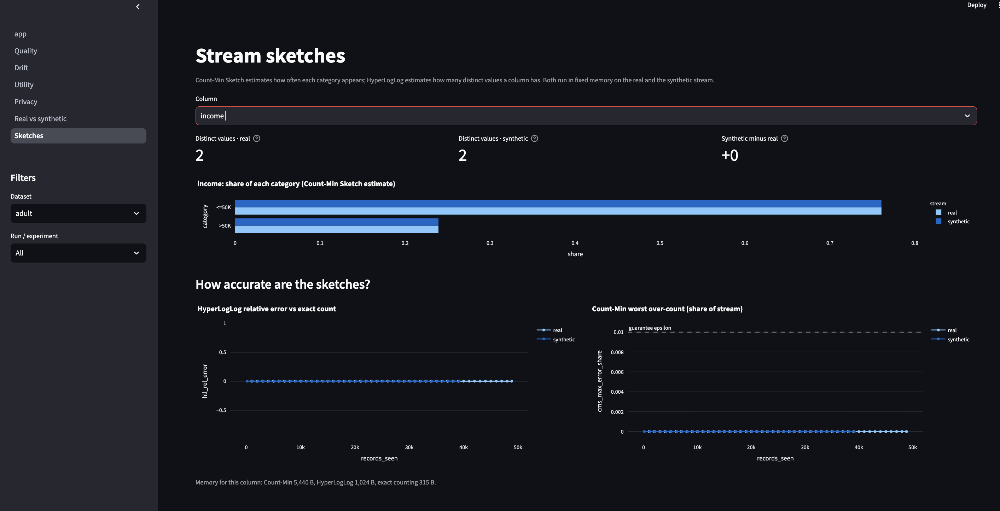

*Figure 8.2. Category shares of `income` in the real and synthetic Adult streams (Count-Min estimate) and the sketches' error against exact counts.*

**Finding.** For low-cardinality columns such as `income` (16 values) or `default_payment_next_month` (2 values), exact counting is cheaper than the sketches (a few hundred bytes against 5,440 + 1,024). Sketches pay off on high-cardinality columns and long streams, where exact memory grows with the number of distinct values while sketch memory stays fixed.

### 8.4 Integration in Docker

`docker/docker-compose.yml` starts Kafka (with topic creation), Kafka UI, InfluxDB, the dashboard and all services for both datasets. Streaming services (quality, DGIM, sketches) run continuously; batch jobs (utility, privacy, drift) compute once, write to InfluxDB and exit with code 0. `depends_on` with health checks starts a service only after Kafka and InfluxDB are ready. The batch jobs, DGIM and the producer share one image (`docker/jobs.Dockerfile`), so it is built once.

### 8.5 Limitations

- Utility, privacy and drift read CSV files in batch rather than consuming Kafka, so their pages fill at once instead of window by window.
- The integer-code rule for categorical columns is a heuristic. A zero-inflated money column such as `capital_gain` can look categorical in the first 1,000 records and is written once before being dropped. Taking the column types from the SDV metadata file, as the drift job does, would remove this.
- The dashboard shows whatever is in the bucket; a clean comparison needs `docker compose down -v` before the run.
- Re-publishing the same topics makes the streaming services count the records again (Count-Min counts grow, HyperLogLog does not), so each stream should be published once per run.
- On macOS with Python 3.14, `pip install -r requirements.txt` fails to build `pillow` for Streamlit 1.39; the host needs Python 3.11 (section 3). The Docker images are unaffected.

**Reproduce:**

```bash
python -m sketches.test_sketches
docker compose -f docker/docker-compose.yml up -d sketches-adult sketches-credit-default dashboard
```

Code: `storage/`, `dashboard/`, `sketches/` · Compose: `docker/docker-compose.yml`

## 9. End-to-end execution

Run commands from the repository root. The examples in this section use **PowerShell**.
Host Python commands require the project virtual environment; Docker commands do not.

**Existing run:** if the canonical CSVs, generated CSVs and Kafka records already
exist, skip phases 1, 2 and 5. To collect missing reservoirs, run phase 6 only with
Kafka running and the jobs image available. Re-running a producer appends another
copy of its rows to Kafka; it does not replace the previous run. Re-running the
generator can replace the synthetic CSVs. Neither is required to collect a sample.

| Phase | Task | Execution |
|---|---|---|
| 1 | Acquire and preprocess real data | Host Python, once for the chosen inputs |
| 2 | Generate synthetic data and evaluate batch quality | Host Python, before publishing synthetic records |
| 3 | Start Kafka, create topics and start InfluxDB | Docker Compose |
| 4 | Start DGIM, quality and sketches before publishing; run batch jobs | Docker Compose |
| 5 | Publish four real/synthetic streams | Docker producer, once per intended replay |
| 6 | Collect and verify four reservoir snapshots | Short Docker jobs, sequentially |
| 7 | Verify outputs and view the dashboard | JSON/CSV evidence plus InfluxDB/dashboard |

### Phases 1–2: prepare inputs on a fresh setup

Skip this block when retaining an existing, approved generation run.

```powershell
python ingestion/download_data.py
python ingestion/preprocess.py
python scripts/generate_synthetic.py --dataset adult --num-rows 40000 --seed 42
python scripts/generate_synthetic.py --dataset credit-default --num-rows 40000 --seed 42
python scripts/evaluate_quality.py --dataset adult
python scripts/evaluate_quality.py --dataset credit-default
```

The canonical producer inputs are `data/processed/<dataset>.csv` and
`data/synthetic/<dataset>-synthetic.csv`. Keep matching metadata and evaluation
outputs with the generation run; do not point services at an older synthetic filename.

### Phases 3–4: start infrastructure and consumers on a fresh setup

```powershell
docker compose -f docker/docker-compose.yml config --quiet
docker compose -f docker/docker-compose.yml build
docker compose -f docker/docker-compose.yml up -d kafka kafka-init influxdb
docker compose -f docker/docker-compose.yml up -d dgim-adult-real dgim-adult-synthetic dgim-credit-default-real dgim-credit-default-synthetic quality-adult quality-credit-default sketches-adult sketches-credit-default
```

Consumers should be ready before phase 5. Inspect `ps -a` and logs if a service exits.
Kafka UI is optional and is omitted from these commands to reduce memory use.
If images and containers already exist, do not rebuild simply to collect reservoirs.

Utility, privacy and the configured Adult drift job read CSVs and exit when done.
They are not triggered by reservoir completion. Run them sequentially to limit peak
memory use when collecting the full project's results:

```powershell
foreach ($job in @("utility-adult", "utility-credit-default", "privacy-adult", "privacy-credit-default", "drift-adult")) {
    docker compose -f docker/docker-compose.yml run --rm --no-deps $job
    if ($LASTEXITCODE -ne 0) { throw "Batch job failed: $job" }
}
```

Successful exit is process evidence; also check each job's output and InfluxDB writes.

### Phase 5: publish each stream once

Skip this block if the intended records have already been published. These producers
run inside Docker and connect to `kafka:9092` rather than the host port.

```powershell
foreach ($dataset in @("adult", "credit-default")) {
    foreach ($source in @("real", "synthetic")) {
        docker compose -f docker/docker-compose.yml run --rm --no-deps producer --dataset $dataset --source $source --rate 50
        if ($LASTEXITCODE -ne 0) { throw "Producer failed: $dataset-$source" }
    }
}
```

`--rate 50` limits the demonstration rate; use `--rate 0` only when the machine can
handle unthrottled publishing. The producer's completion log alone is not proof of
full retained payload coverage. Retention, earlier replays and delivery failures
must be considered when comparing Kafka with a CSV.

### Phase 6: run reservoir sampling inside Docker

Requires the on-demand `reservoir` service in `docker/docker-compose.yml` and the
independent consumer settings described in section 4. Kafka and the four topics must
already exist; `--no-deps` deliberately avoids starting additional services.

```powershell
foreach ($dataset in @("adult", "credit-default")) {
    foreach ($source in @("real", "synthetic")) {
        docker compose -f docker/docker-compose.yml run --rm --no-deps reservoir --dataset $dataset --source $source
        if ($LASTEXITCODE -ne 0) { throw "Sampling failed: $dataset-$source" }

        $file = "data/reference/$dataset-$source-reservoir.json"
        $sample = Get-Content $file -Raw | ConvertFrom-Json
        $expected = [Math]::Min(1000, [long]$sample.records_seen)
        if ($sample.dataset -ne $dataset -or $sample.source -ne $source -or
            $sample.reservoir_size -ne 1000 -or $sample.records_seen -le 0 -or
            $sample.records_held -ne $expected -or
            @($sample.sample).Count -ne $expected) {
            throw "Invalid reservoir: $file"
        }
        Write-Host "PASS $dataset-$source : seen=$($sample.records_seen), held=$($sample.records_held)"
    }
}
```

The four jobs run sequentially. A 15-second quiet wait before each exits is normal.
The outputs are:

- `data/reference/adult-real-reservoir.json`
- `data/reference/adult-synthetic-reservoir.json`
- `data/reference/credit-default-real-reservoir.json`
- `data/reference/credit-default-synthetic-reservoir.json`

This checks non-empty snapshots, source identity and sample size. It does not prove
full source-file coverage or verify downstream InfluxDB writes. A timeout is an idle
condition, not an explicit end-of-stream marker; publish the complete intended input
before starting these finite jobs.

### Phase 7: verify evidence and view results

Algorithm checks can also run inside the existing jobs image:

```powershell
docker compose -f docker/docker-compose.yml run --rm --no-deps --entrypoint python producer ingestion/test_reservoir.py
docker compose -f docker/docker-compose.yml run --rm --no-deps --entrypoint python producer ingestion/test_dgim.py
```

For the ingestion/synthesis handoff, retain evidence of:

- Canonical and synthetic row counts, matching columns, metadata and generation quality reports.
- Producer completion and retained Kafka coverage for each topic; disclose discrepancies.
- All four reservoir snapshots, their records-seen counts and sample-size checks.
- DGIM snapshots with nonzero records seen and the expected dataset-specific rates.
- Actual downstream CSV/InfluxDB results for the intended run, rather than container status alone.

`data/reference/` is ignored by Git. Submit snapshots separately if execution evidence
is required; committing source code does not include these generated artifacts.

Start the dashboard after processing, especially on a memory-constrained machine:

```powershell
docker compose -f docker/docker-compose.yml up -d dashboard
docker compose -f docker/docker-compose.yml ps -a
```

Dashboard: http://localhost:8501. It may show historical results until new metrics
have been written. The optional Kafka UI is available at http://localhost:8081 only
if its service has been started.

### Preserve an existing run

```powershell
docker compose -f docker/docker-compose.yml stop
```

This stops containers while preserving their data. `start` resumes existing containers;
it does not apply changed image contents, environment variables or Compose configuration.
The on-demand reservoir job creates its own temporary container and reads the current
bind-mounted source. Do not delete Kafka or InfluxDB volumes to add sampling.

## 10. Results

## 11. Known issues and limitations

- Reservoir snapshots are uniform over retained arrivals, not recent windows or unique payloads. Retention and repeated publishing change the sampled population; the seed does not undo that.
- A recorded run reported 48,719 retained Adult-real offsets versus 48,842 CSV rows (a difference of 123). The cause and payload coverage were not established. Matching counts for other topics alone do not prove identity either. Do not label the full input as verified on that evidence.
- DGIM currently keeps its algorithm state in memory while its normal Kafka group commits offsets. After a restart, new counters can resume partway through a topic. Its periodic snapshot can also lag the last partial report interval during an idle, long-running job. Continuous restart recovery and a guaranteed final snapshot on Docker termination are not established by the current implementation; use a deliberate independent replay for full-history validation and avoid concurrent writers for the same snapshot.
- Reservoir JSON files are not automatically consumed by quality, utility or privacy, and are not automatically displayed in the dashboard. Older wording in `docs/stream-contract.md` describing a shared reservoir/DGIM group or automatic reference-file consumption is superseded by sections 4 and 9 here; those interface statements need team alignment.
- The checked-in generation summaries and README narrative may describe different evaluation runs. Use the matching `results/<dataset>-summary.json` and CSV reports as the numerical evidence for the submitted generation; do not mix runs.

- SDV prints `UserWarning: We strongly recommend saving the metadata using 'save_to_json'` during fitting. This refers to the internal training metadata. The metadata that other services read (`data/synthetic/<dataset>-metadata.json`) is saved. The warning does not affect the output.
- SDMetrics prints a `FutureWarning` that its single-table quality report is deprecated. The scores are unaffected; the import should be updated to `sdmetrics.reports.QualityReport` in a later version.
- The Gaussian copula truncates heavy tails: `capital_gain` (Adult) and `pay_amt*` (Credit Default) reach only a fraction of the real maximum, though their means and spreads are correct.
- It cannot enforce logical rules between categorical columns on its own; the Adult `relationship`/`sex`/`marital_status` rule is handled with a `FixedCombinations` constraint, but other latent rules may remain (section 5.4).
- For Credit Default, modelling `pay_*` as categorical improves their marginals at a cost to cross-column correlation (column pair trends 0.92 to 0.84). See section 5.4 for the reasoning behind keeping it.
## 12. Conclusion and future work
## 13. References

- Becker, B. and Kohavi, R. (1996). *Adult*. UCI Machine Learning Repository.
- Yeh, I-C. (2009). *Default of Credit Card Clients*. UCI Machine Learning Repository.
- Patki, N., Wedge, R. and Veeramachaneni, K. (2016). *The Synthetic Data Vault*. IEEE DSAA.
- Bifet, A. and Gavaldà, R. (2007). Learning from time-changing data with adaptive windowing. SIAM International Conference on Data Mining.
- Page, E. S. (1954). Continuous inspection schemes. *Biometrika*, 41(1/2), 100–115.
- Domingos, P. and Hulten, G. (2000). Mining high-speed data streams. *Proceedings of the 6th ACM SIGKDD International Conference on Knowledge Discovery and Data Mining*, 71–80.
- Bloom, B. H. (1970). Space/time trade-offs in hash coding with allowable errors. *Communications of the ACM*, 13(7), 422–426.
- Kirsch, A. and Mitzenmacher, M. (2006). Less hashing, same performance: building a better Bloom filter. *European Symposium on Algorithms (ESA)*, 456–467.
- Esteban, C., Hyland, S. L. and Rätsch, G. (2017). Real-valued (medical) time series generation with recurrent conditional GANs. arXiv:1706.02633.
- Brodersen, K. H., Ong, C. S., Stephan, K. E. and Buhmann, J. M. (2010). The balanced accuracy and its posterior distribution. *20th International Conference on Pattern Recognition (ICPR)*, 3121–3124.
- Aggarwal, C. C., Han, J., Wang, J. and Yu, P. S. (2003). A Framework for Clustering Evolving Data Streams. *Proceedings of the 29th International Conference on Very Large Data Bases (VLDB)*, pp. 81-92.
- Cao, F., Ester, M., Qian, W. and Zhou, A. (2006). Density-Based Clustering over an Evolving Data Stream with Noise. *Proceedings of the 2006 SIAM International Conference on Data Mining (SDM)*, pp. 328-339.
